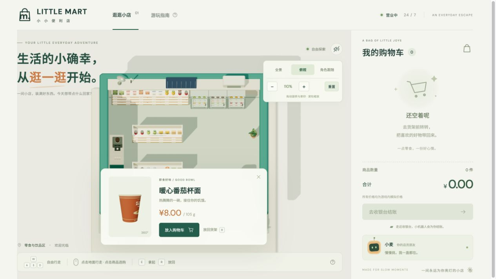

# 小小便利店 · LITTLE MART

一间可以走进去的 Three.js 便利店。操控第三人称角色逛货架、查看商品包装与价格，把喜欢的商品放进购物车，再交给机器人小麦结账。

**[在线游玩](https://mzvast.github.io/convenience-store/)** · [源代码](https://github.com/mzvast/convenience-store) · [部署状态](https://github.com/mzvast/convenience-store/actions/workflows/pages.yml)



## 快速开始

在线体验：打开上方“在线游玩”，直接进入小店。建议先选择“俯视”熟悉布局，再切换“角色跟随”选购。

本地运行需要 Node.js 22 或更新版本：

```bash
git clone https://github.com/mzvast/convenience-store.git
cd convenience-store
npm run dev
```

打开终端提示的 [本地地址](http://127.0.0.1:4173/)。Three.js 已随项目提供，启动时直接运行上述命令即可。

浏览器需要支持 WebGL 2，并启用硬件加速。通过本地服务器或在线地址访问，浏览器会正常加载原生 ES 模块。

## 如何游玩

1. **进入小店**：用 WASD、方向键或点击地面行走。角色会绕过货架和收银台。触屏可使用左下方向按钮。
2. **选购商品**：点击商品，角色会自动走近并拿起；也可以靠近货架后按 E。商品面板展示包装、规格、说明和价格。
3. **整理购物车**：点击“放入购物车”保存商品，按 R 或点击“放回货架”归还。购物车加减按钮可调整数量，场景库存与购物车同步更新。
4. **找小麦结账**：带着购物车走近右前方收银台，机器人会自动逐件扫描商品并打印小票。“去收银台结账”按钮可引导角色走过去。
5. **继续逛逛**：关闭小票后继续选购。购买的商品在本次访问中保持售出状态。

| 操作 | 方式 |
| --- | --- |
| 行走 | WASD / 方向键 / 点击地面 / 触屏方向按钮 |
| 拿起附近商品 | E / 点击商品 |
| 放回手中商品 | R / Esc / “放回货架” |
| 加入购物车 | 商品面板的“放入购物车” |
| 切换镜头 | “全景”“俯视”“角色跟随”按钮 |
| 调整水平角度与俯仰角 | 鼠标左键或右键拖动，触屏单指拖动 |
| 缩放 | 滚轮 / 镜头面板的 ＋、−，范围 55%～280% |
| 恢复当前镜头 | “重置”，恢复该视角的默认角度与倍率 |
| 打开音效 | 右上方扬声器按钮 |
| 查看指南 | “游玩指南” / 底部问号按钮 |

室内探索时，靠近镜头的门头和墙体会自动淡化，方便观察角色、货架与机器人。镜头旋转后，键盘行走方向会与镜头保持一致。

结账为游戏内模拟支付。商品品牌与价格均为本演示的原创内容。库存、购物车和小票保存在当前页面会话中，刷新页面会重置。

## 本地检查

```bash
npm test
```

检查覆盖实物商品拿取与归还、购物车数量与金额、库存一致性以及重复结账保护。金额使用整数分计算。

## 发布到 GitHub Pages

此仓库通过 [GitHub Actions 工作流](.github/workflows/pages.yml) 自动发布：

1. 在仓库 **Settings → Pages → Build and deployment** 中，将 **Source** 设为 **GitHub Actions**。
2. 向 `main` 分支推送修改，或进入 **Actions → Deploy GitHub Pages → Run workflow** 手动发布。
3. 工作流使用 Node.js 24 进行语法检查和购物逻辑测试，然后上传 `dist/` 并部署到 GitHub Pages。
4. 工作流完成后，打开仓库 Pages 页面给出的在线地址。

部署自己的副本时，先 Fork 或创建自己的仓库，再按上述步骤启用 Pages，并将 README 中的仓库和在线体验链接替换成自己的地址。Fork 的仓库可在 Actions 页面启用工作流后再发布。

所有应用资源均使用相对路径，适用于 GitHub Pages 的仓库子路径。`dist/` 已包含完整静态应用，可直接托管。

## 项目结构

| 路径 | 内容 |
| --- | --- |
| `dist/index.html` | 页面入口、购物车、商品面板与游玩指南 |
| `dist/style.css` | 页面样式与屏幕尺寸适配 |
| `dist/world.js` | 店面、商品模型、角色、镜头、寻路和交互 |
| `dist/shop.js` | 商品目录、库存、购物车与结账逻辑 |
| `dist/app.js` | 界面更新、音效、机器人扫描和小票 |
| `dist/vendor/` | Three.js 0.180.0 与第三方许可证 |
| `server.mjs` | 本地静态服务器 |
| `shop.test.mjs` | 购物逻辑检查 |
| `.github/workflows/pages.yml` | GitHub Pages 自动发布 |

商品采用几何模型与本地 Canvas 包装纹理，包含瓶盖、罐口、拉环、纸盒折顶和零食袋封边。字体通过 Google Fonts 加载，网络不可用时回退到系统字体。Three.js、商品包装和购物逻辑均由本站提供。

Third-party license: [Three.js MIT License](dist/vendor/THREE-LICENSE.txt)。

## 常见问题

- **页面空白或提示无法开门**：确认浏览器支持 WebGL 2，开启硬件加速后刷新。
- **视角遮挡商品**：选择“俯视”或“角色跟随”，拖动调整角度，按需缩放。
- **本地提示端口占用**：本地服务器固定使用 4173 端口，保留一个服务器实例即可。
- **Pages 返回 404**：检查 Pages 的 Source 是否为 GitHub Actions，以及最近一次部署工作流是否成功。
